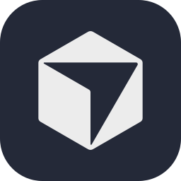

# Hi, I'm Dan Zadobrischi · `dagaza`

**Copenhagen · The Public Domain**

---

## Featured projects

<table>
  <tr>
    <td width="50%" valign="top">
      <h3> <a href="https://github.com/dagaza/Qube">Qube</a></h3>
      
Privacy-first desktop AI assistant: personal knowledge, long-term memory, and citation-grounded answers — entirely on your hardware.

      
<strong>Stack:</strong> Python · local LLMs · agents

      
🌐 <a href="https://qubeapp.eu">qubeapp.eu</a> · ⭐ <a href="https://github.com/dagaza/Qube">GitHub</a>

    </td>
    <td width="50%" valign="top">
      <h3> <a href="https://github.com/dagaza/InkBridge">InkBridge</a></h3>
      
Turn any Android device into a high-precision input surface for Linux — pressure, tilt, and low latency for artists and creators. A SuperDisplay-style alternative for the FOSS desktop.

      
<strong>Stack:</strong> C++ · C · CMake · Linux

      
⭐ <a href="https://github.com/dagaza/InkBridge">github.com/dagaza/InkBridge</a>

    </td>
  </tr>
  <tr>
    <td width="50%" valign="top">
      <h3> <a href="https://github.com/dagaza/FlipStack">FlipStack</a></h3>
      
Modern flashcards for Linux with spaced repetition (SRS). Native GTK4 / Libadwaita experience on desktop and mobile form factors.

      
<strong>Stack:</strong> Python · GTK4 · Libadwaita

      
⭐ <a href="https://github.com/dagaza/FlipStack">github.com/dagaza/FlipStack</a>

    </td>
    <td width="50%" valign="top">
      <h3>More</h3>
      
Packaging & tooling around Qube, Home Assistant wake-word collections, and other FOSS experiments.

      
<a href="https://github.com/dagaza?tab=repositories">Browse all repositories →</a>

    </td>
  </tr>
</table>

---

## More about me

### Product & platforms

Building and scaling **Qube** and **Plus One**. Day-to-day product architecture and leadership with Figma, Excalidraw, Cursor, and Azure DevOps, with ongoing research in AI, design, and systems thinking. Designed, architected, and product-managed CRMs, ERPs, KMSs, ATSs, CMSs, and marketing automation software.

### Applied AI & digital craft

Designed, trained, and deployed agentic LLM systems for customer support, sales outreach, onboarding, internal operations, and recruiting, plus ML for prediction, scoring, and recommendations. Tailored websites and digital footprints for local small businesses and professional portfolios.

### Leadership & advisory

Directed 20+ direct reports and cross-functional teams spanning 100+ contributors across product and engineering. Mentored engineering, business, and social science students on academic rigor, methodology, and philosophy of science—project scoping, literature reviews, stakeholder navigation, and emerging-tech roadmaps (AI, IoT, XR). Ten-plus years of early-career business consulting inform advisory work with founders and early-stage teams.

---

## What I care about

Open Source • Interoperability • Repairability • Sustainability • Local-first • Inspectable AI • Business Ethics • Legendary UX

---

## Tech I work with

  
  
  

---

## 🤝 Let's collaborate

I'm open to:

- Working on open-source projects
- Joining exciting tech teams
- Helping small businesses build useful apps or websites

Reach out on [LinkedIn](https://www.linkedin.com/in/dagaza) or via [danzadobrischi.com](https://www.danzadobrischi.com/).

---

## GitHub activity

  
  

  

---

**If something here helps you, a star on a repo is always appreciated.**

